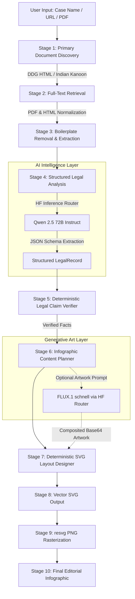

<div align="center">

# ⚖️ LEGAL SNAPS
### Editorial Infographic Engine for Landmark Legal Judgments

*Turn complex judicial rulings into verifiable, single-page editorial infographics powered by structured LLM reasoning and deterministic vector typesetting.*

[](https://nextjs.org/)
[](https://react.dev/)
[](https://fastapi.tiangolo.com/)
[](https://tailwindcss.com/)
[](https://huggingface.co/Qwen/Qwen2.5-72B-Instruct)
[](https://blackforestlabs.ai/)

---

</div>

## 📖 Overview

**Legal Snaps** is an end-to-end intelligence pipeline that ingests a case name, judgment citation, article URL, or PDF link, retrieves the **verifiable primary legal document**, extracts the official judgment text, structures the claims using **Qwen 2.5 72B**, cross-verifies all extracted claims deterministically against the source text, and generates a museum-grade vector infographic (`.svg` and high-res `.png` via `resvg`).

> [!IMPORTANT]
> **No Hallucinated Law:** Legal text is **never** drawn by a diffusion image model. Text elements, statutes, citations, and holdings are rendered via a deterministic vector typography engine. Image models (FLUX.1) are reserved strictly for thematic visual artwork composited beneath the typography.

---

## ✨ Highlights & Features

### 💡 Interactive Ambient Lamp & "Blackout" Reveal
- **Physics-Based Pendant Lamp:** Features an interactive vintage brass pendant lamp with genuine damped harmonic spring recoil ($y$), gravity pendulum swing ($\theta$), and 3D torsional cord twist (`rotateY`).
- **Blackout Start & Pull-to-Reveal:** The application opens in total darkness with only the hanging lamp and pull-chain illuminated. Pulling or clicking the lamp toggles the incandescent filament on, fading out the dark veil to reveal the entire legal workspace in warm ambient light.
- **Physical Tension:** Features elastic resistance when dragged downwards, an authentic multi-bounce recoil on release, and dynamic cursor tracking.

### 🏛️ Primary Document Grounding
- **Autonomous Discovery:** Automatically queries DuckDuckGo and Indian Kanoon to discover authentic Supreme Court / High Court filings.
- **Boilerplate Stripping:** Filters out administrative noise, headnotes, court registries, and header pagination to isolate the pure judicial corpus.

### 🔍 Deterministic Claim Verification
- Every claim, precedent, statutory article, and ruling point extracted by the LLM is programmatically audited against the raw primary text. Unverified claims are flagged or discarded before layout generation.

### 🎨 Editorial Vector Typography
- High-fidelity typography built with **Instrument Serif**, **Instrument Sans**, and **IBM Plex Mono**.
- Produces clean vector SVGs with crisp proportional columns, metadata ribbons, ratio-balanced timelines, and legal citation badges.

---

## 🏗️ System Architecture



---

## 🛠️ Tech Stack

| Layer | Technology | Details |
| :--- | :--- | :--- |
| **Frontend Framework** | **Next.js 16 (Turbopack)** | Server/Client components, App Router, TypeScript |
| **UI Library & State** | **React 19** | Dynamic reactive hooks, pointer-capture simulation loop |
| **Styling & Theme** | **Tailwind CSS v4** | Dark editorial aesthetic, custom radial gradients, glassmorphism |
| **Typography** | **Google Fonts** | `Instrument Serif`, `Instrument Sans`, `IBM Plex Mono` |
| **Backend API** | **FastAPI (Python 3.11+)** | Asynchronous endpoint orchestration, SSE event streaming |
| **LLM Reasoning** | **Qwen/Qwen2.5-72B-Instruct** | Strict JSON schema extraction through Hugging Face Router |
| **Generative Artwork** | **black-forest-labs/FLUX.1-schnell** | Editorial thematic illustration compositing |
| **Vector Engine** | **Native SVG Generator** | Deterministic XML tree calculation with dynamic flow bounds |
| **Rasterization** | **resvg-py** | Sub-pixel accurate SVG to PNG rendering |
| **Persistence** | **SQLite** | Local metadata caching and artifact storage |

---

## 🚀 Quick Start

### 1. Prerequisites
- **Node.js** 20.x or higher
- **Python** 3.11 or higher
- A **Hugging Face API Token** with inference provider access

---

### 2. Backend Setup

```bash
# Navigate to backend directory
cd backend

# Create and activate Python virtual environment
python3 -m venv .venv
source .venv/bin/activate  # On Windows: .venv\Scripts\activate

# Install dependencies
pip install -r requirements.txt

# Configure environment
cp ../.env.example .env
# Edit .env and insert your HF_TOKEN
```

Run the backend development server:
```bash
./.venv/bin/uvicorn app.main:app --reload --port 8000
```
*API documentation will be available at [http://localhost:8000/docs](http://localhost:8000/docs).*

---

### 3. Frontend Setup

In a new terminal window:

```bash
# Navigate to frontend directory
cd frontend

# Install dependencies
npm install

# Start Next.js development server
npm run dev
```

Open **[http://localhost:3000](http://localhost:3000)** in your browser.

> [!TIP]
> **Try the Lamp:** The website loads in pitch darkness. Click or pull down the vintage pendant lamp at the top of the screen to reveal the application.

---

## 🧪 Testing & Verification

### Backend Test Suite
The backend contains comprehensive unit tests and offline/live integration suites:

```bash
cd backend
# Run fast offline test suite (no network or API token required)
./.venv/bin/python -m pytest -q

# Run end-to-end live integration test suite
RUN_LIVE_TESTS=1 ./.venv/bin/python -m pytest tests/test_live_integration.py -v -s
```

### Frontend Typecheck & Lint
```bash
cd frontend
npx tsc --noEmit
npm run lint
```

---

## 📁 Repository Structure

```
legal-snaps/
├── backend/
│   ├── app/
│   │   ├── api/             # FastAPI routers & endpoints
│   │   ├── pipeline/        # 10-stage processing pipeline
│   │   │   ├── discovery.py         # Case search & search engine fallback
│   │   │   ├── retrieval.py         # Document fetching & parsing
│   │   │   ├── extraction.py        # Judicial text normalization
│   │   │   ├── hf_ai.py             # Qwen 2.5 & FLUX.1 HF Router clients
│   │   │   ├── legal_validator.py   # Deterministic claim verification
│   │   │   ├── content_planner.py   # Infographic structured layout planning
│   │   │   ├── svg_designer.py      # Deterministic SVG typesetting
│   │   │   ├── png_renderer.py      # resvg rasterization
│   │   │   └── orchestrator.py      # Pipeline runner & error boundary
│   │   ├── config.py        # Environment & token configuration
│   │   ├── database.py      # SQLite connection & schema models
│   │   └── main.py          # Application entrypoint
│   ├── tests/               # Pytest suite & integration fixtures
│   └── requirements.txt     # Python package dependencies
│
├── frontend/
│   ├── src/
│   │   ├── app/
│   │   │   ├── globals.css  # Typography tokens, lamp physics & dark veil
│   │   │   ├── layout.tsx   # Root layout with SSR data-lamp state
│   │   │   └── page.tsx     # Hero section, case form, timeline & viewer
│   │   ├── components/
│   │   │   ├── AmbientField.tsx        # Damped pendulum & 3D twist pull-lamp
│   │   │   ├── Header.tsx              # Navigation & health status
│   │   │   ├── ArticleInputForm.tsx    # Case name & URL submission
│   │   │   ├── ProcessingTimeline.tsx  # Live 10-stage status tracker
│   │   │   ├── InfographicViewer.tsx   # SVG / PNG preview & downloader
│   │   │   └── LegalValidationCard.tsx # Verifiable source claims checklist
│   │   └── lib/
│   │       └── api.ts       # Backend HTTP & SSE client
│   ├── package.json
│   └── tsconfig.json
│
├── .env.example             # Example environment variables
├── .gitignore               # Ignored venv, node_modules, and cache files
└── README.md                # Project documentation
```

---

## 🔒 Security & Privacy

- **Primary Source Integrity:** Claims are verified against retrieved case law to prevent AI confabulation.
- **Sandboxed Token Handling:** API tokens are isolated in `backend/.env` and never forwarded to client-side code.
- **Fail-Safe Degradation:** If model providers reject requests due to rate limits or credits, generation terminates transparently at Stage 4 with the specific provider error surfaced to the user.

---

## ⚖️ License

Distributed under the **MIT License**. See `LICENSE` for more information.

<div align="center">
<sub>Crafted with precision for legal clarity and typographic beauty.</sub>
</div>
